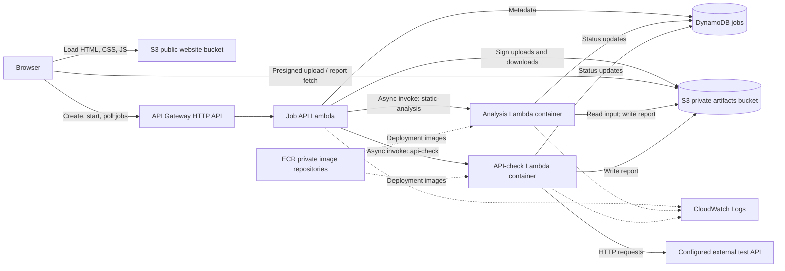
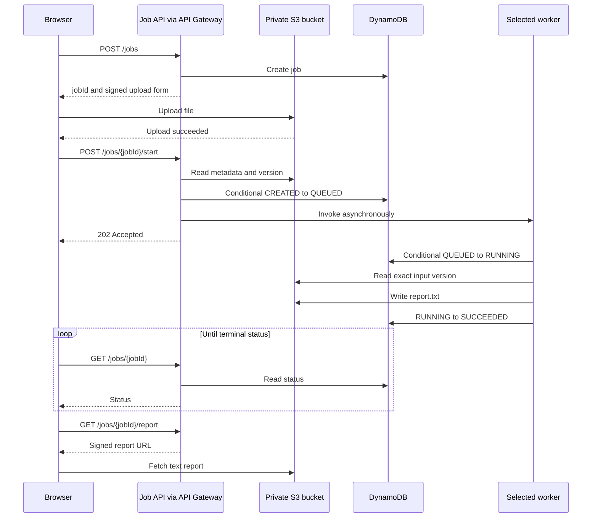

# AWS serverless code-checking demo

Architecture proposal · 22 September 2026 · Infrastructure as code: Terraform

This design runs two independent JavaScript tools as AWS Lambda container functions. A static S3 website submits jobs through API Gateway, polls their status, and displays or downloads plain-text reports. S3 stores files; DynamoDB stores job metadata. Lambda's asynchronous invocation queue is sufficient for Phase 1, so a separate SQS queue is optional future work.

The target is a small learning project with minimal recurring cost and approximately $50 of available AWS credits. This document specifies the architecture and Terraform implementation plan; it does not provision infrastructure or include a complete application implementation.

## 1. Scope and working assumptions

| Requirement | Design decision |
|---|---|
| Two existing JavaScript services | Extract their processing functions from the HTTP servers; invoke them through Lambda handlers |
| Static analysis | Inspect uploaded text with the existing regex rules; never execute uploaded code |
| External API check | Make a few requests to a configured test API; no API credentials assumed |
| Independent services | One job selects one tool; neither tool automatically invokes the other |
| Browser frontend | Plain HTML, CSS, and JavaScript, with a small public configuration JSON file |
| Accepted uploads | ZIP, TAR, or plain-text files; compressed TAR variants only if the existing parser supports them |
| Asynchronous UI | Submit, show status, reopen a job, view its report, download `.txt` |
| Authentication | None for this demo; no users, accounts, or private per-user history |
| Infrastructure | Terraform, one AWS account, one region |
| Phase 1 operations | Standard AWS Lambda logs only |
| Phase 2 operations | Monitoring, alerting, richer logs, and optional reliability improvements |

The following are proposed starting values, not measured requirements:

- Region: `us-east-1` for consistent examples; keep all regional resources together.
- Upload limit: 5 MiB; expanded archive limit: 20 MiB and 500 entries.
- Report limit: 1 MiB of UTF-8 text. If findings exceed it, include a truncation notice.
- External API requests: at most five per job, with a five-second timeout per request.
- Job submission must happen within one hour of creation. Processing deadline: ten minutes after submission.
- Reports and metadata remain available for seven days. Uploads are eligible for lifecycle cleanup after one day.
- Service 2 takes small JSON parameters, not the output of service 1. If it also needs an uploaded file, reuse the upload flow.

The external test API's actual URL and parameter schema remain deployment inputs. Account age, account plan, and credit expiry are also unknown; the cost estimate does not assume every resource is free.

## 2. Architecture



There are **three Lambda functions**: the two business services and one small job API function. The API function handles HTTP requests, metadata, and signed URLs; it does not run scans. Package this small function as a ZIP to avoid maintaining a third container image.

| Component | Responsibility | Initial configuration |
|---|---|---|
| S3 website bucket | Public frontend assets only | Static website hosting, `index.html`, no public writes |
| API Gateway HTTP API | Browser-facing routes and CORS | Lambda proxy integration, payload format `2.0`, `$default` stage |
| Job API Lambda | Create/start jobs, return status and report links | Node.js, ZIP, 256 MiB, 10-second timeout |
| Analysis Lambda | Regex checks over uploaded text | Container image, 512 MiB, 60-second timeout |
| API-check Lambda | Call the configured external API | Container image, 256 MiB, 60-second timeout |
| Two private ECR repositories | Store the two worker images | Immutable release tags; deploy using image digests |
| S3 artifacts bucket | Inputs and text reports | Private, versioning, encryption, lifecycle rules |
| DynamoDB jobs table | One item per job | Standard class, on-demand billing, TTL, no indexes |
| Three CloudWatch log groups | Normal Lambda output | Seven-day retention |

Do not attach the functions to a customer VPC. Their default networking can reach public APIs and AWS services, so this application needs no NAT gateway, subnets, load balancer, or VPC endpoints. [AWS Lambda networking](https://docs.aws.amazon.com/lambda/latest/dg/configuration-vpc.html)

### Why no SQS initially?

The job API invokes the selected worker using the Lambda SDK with `InvocationType: "Event"`. Lambda accepts the event into its managed asynchronous queue and the API can return immediately. It must await that acceptance before reporting a successful submission; launching unawaited background work inside the HTTP handler is insufficient. [Lambda asynchronous invocation](https://docs.aws.amazon.com/lambda/latest/dg/invocation-async.html)

A separate SQS queue becomes useful for a queue-management exercise, controlled consumer throughput, longer backlogs, or dead-letter redrive. Those are not current requirements. Lambda still needs duplicate-safe processing because asynchronous delivery can occur more than once. [Lambda error handling and delivery behavior](https://docs.aws.amazon.com/lambda/latest/dg/invocation-async-error-handling.html)

The internal worker event contains only `jobId`. Each worker loads the canonical record from DynamoDB, checks that its job type matches, and uses the stored input references or parameters. Uploaded files are never embedded in the invocation event.

## 3. Job flow

### Static-analysis job

1. The user selects **Static analysis** and chooses a file.
2. The browser calls `POST /jobs` with its type and file metadata.
3. The job API creates a random job ID and a DynamoDB item in `CREATED`, then returns an S3 presigned POST form valid for five minutes.
4. The browser uploads the file directly to the private artifacts bucket. File bytes do not pass through API Gateway.
5. After upload succeeds, the browser calls `POST /jobs/{jobId}/start`.
6. The API checks the stored job, reads S3 object metadata, verifies size, and records the object's `VersionId`. It conditionally changes `CREATED` to `QUEUED` and invokes the analysis worker asynchronously.
7. The worker conditionally claims the job, changes it to `RUNNING`, reads that exact object version, checks its contents, and writes a text report.
8. The worker records the report key/version and changes the job to `SUCCEEDED`. Findings are a successful scan result; processing failures produce `FAILED`.
9. The browser polls job status and, on success, fetches a short-lived signed report URL for display or download.



### External API job

The user selects **API check** and supplies the tool's small input parameters. Creation returns a job ID without an upload form; the UI immediately calls the same start endpoint. The selected worker reads the parameters from DynamoDB, calls the configured test API, and stores its own text report.

The API base URL is a deployment setting. The browser supplies only the supported parameters, not an arbitrary destination URL. Neither worker depends on the other's completion.

## 4. API and frontend contract

| Route | Purpose | Successful response |
|---|---|---|
| `POST /jobs` | Validate job type and input metadata/parameters; create job | `201`, job ID, status URL, optional signed upload form |
| `POST /jobs/{jobId}/start` | Validate readiness and submit selected worker | `202` after Lambda accepts the event |
| `GET /jobs/{jobId}` | Return state and safe error details | `200`, job metadata |
| `GET /jobs/{jobId}/report` | Request access to completed text report | `200`, signed HTTPS URL valid for 60 seconds |

Example job creation:

```json
{
  "type": "static-analysis",
  "file": {
    "name": "sample.zip",
    "sizeBytes": 24576,
    "contentType": "application/zip"
  }
}
```

Example status response:

```json
{
  "jobId": "fc463c58-63c9-4912-a563-d812b8ddda10",
  "type": "static-analysis",
  "status": "SUCCEEDED",
  "createdAt": "2026-09-22T18:00:00Z",
  "finishedAt": "2026-09-22T18:00:06Z",
  "reportAvailable": true
}
```

Use `400` for invalid parameters, `404` for an unknown job, `409` for a missing upload or unavailable report, and `410` for an expired job still present in storage. After TTL deletion, an expired job may return `404`. Throttling returns `429`; temporary infrastructure failures return `503`.

A repeated start request returns the existing state and does not dispatch another worker. A fresh user retry creates a new job ID; it never resets a completed job. If a start response is lost or uncertain, the UI checks status before offering a new submission. An upload form that expires can be replaced by creating a fresh job and uploading again.

The frontend needs one page with a tool selector, input controls, a submit button, status, a report area, and a download button. Poll every two seconds initially, then every five seconds; stop at a terminal state or expiry and back off after `429`/network errors. Show stage names rather than an invented completion percentage.

Keep recent job IDs in browser `localStorage` and support a bookmark such as `/#job=<jobId>`. Reopening the page resumes status checks. This is browser-local history; there is no global `GET /jobs` listing. Losing the ID means losing the convenient way to retrieve the job.

Render reports using `textContent` inside a `<pre>` element, never `innerHTML`. The report can contain source-code snippets. For downloads, fetch the text, create a browser Blob, and download `report-<jobId>.txt`.

## 5. Data and file storage

### DynamoDB

Use a single partition key, `jobId` (string), with no sort key or secondary indexes. All reads are direct lookups. Keep records small; report bodies and source code belong in S3.

| Attribute | Purpose |
|---|---|
| `jobId` | Random UUID generated by the API |
| `type` | `static-analysis` or `api-check` |
| `status` | `CREATED`, `QUEUED`, `RUNNING`, `SUCCEEDED`, `FAILED` |
| `createdAt`, `queuedAt`, `startedAt`, `finishedAt` | ISO timestamps for the UI |
| `parameters` | Validated, bounded external-check input; maximum 4 KiB |
| `inputKey`, `inputVersionId`, `inputSizeBytes` | Exact uploaded object, when required |
| `reportKey`, `reportVersionId` | Exact report object, after completion |
| `deadlineAt` | Epoch seconds; set to submission time plus ten minutes |
| `executionId` | Worker invocation ID used to guard completion updates |
| `errorCode`, `errorMessage` | Brief, safe failure details |
| `expiresAt` | Epoch seconds; creation time plus seven days; DynamoDB TTL attribute |

Use conditional updates to enforce transitions. For example, the worker may claim a job only if `status = QUEUED` and its deadline has not passed. Finish updates must still match `RUNNING` and the recorded `executionId`. A duplicate invocation that cannot claim the job exits successfully without running the tool.

Use strongly consistent `GetItem` reads for status and submission checks. TTL is cleanup, not an exact expiry timer: the API must check `expiresAt` itself and refuse access after expiry. AWS may delete expired items several days later. [DynamoDB TTL](https://docs.aws.amazon.com/amazondynamodb/latest/developerguide/TTL.html)

### S3

Use two buckets:

```text
website bucket — public read of frontend assets
  index.html
  styles.css
  app.js
  config.json

artifacts bucket — private
  inputs/<jobId>/source
  reports/<jobId>/report.txt
```

Keep the original filename in metadata if useful; generate storage keys on the server. The browser cannot choose arbitrary bucket names or object keys.

For uploads, the presigned POST policy fixes the exact object key and bounds file size to 1 byte–5 MiB. Validate archive format and contents inside the worker; a filename or browser-provided content type is not proof of format. [S3 POST policy conditions](https://docs.aws.amazon.com/AmazonS3/latest/developerguide/sigv4-HTTPPOSTConstructPolicy.html)

Enable versioning on the artifacts bucket and pin the input version when starting a job. This prevents reuse of an unexpired upload form from changing the file that the running job reads. Store the report's returned version ID as well. Versioning creates billable copies, so configure lifecycle rules for both current and noncurrent versions. [S3 versioning and lifecycle](https://docs.aws.amazon.com/AmazonS3/latest/userguide/Versioning.html)

| Data | Cleanup policy |
|---|---|
| Current input objects | Expire after one day |
| Noncurrent input versions | Delete after one day as noncurrent |
| Current reports | Expire after seven days |
| Noncurrent report versions | Delete after one day as noncurrent |
| Expired delete markers | Remove when eligible |
| Incomplete multipart uploads | Abort after one day |
| Job metadata | TTL after seven days |

Lifecycle cleanup is asynchronous and versioned objects can remain beyond the initial expiration date. These are storage cleanup targets, not guarantees of physical deletion at an exact hour. The API's seven-day check defines report availability.

## 6. Adapting the JavaScript services

Separate each tool's core function from its HTTP server. Its Lambda handler loads job input, calls the core function, writes the report, and updates the job. Do not call `app.listen()` in the worker entry point.

Suggested application structure:

```text
services/
  analysis/
    src/analyze.js       # existing regex logic
    src/handler.js       # Lambda adapter
    Dockerfile
    package.json
  api-check/
    src/check.js         # existing external API logic
    src/handler.js       # Lambda adapter
    Dockerfile
    package.json
  job-api/
    src/handler.js       # API Gateway adapter and job operations
    package.json
frontend/
  index.html
  styles.css
  app.js
```

Use an AWS Lambda Node.js base image, currently Node.js 24, and export the configured handler. It already provides the Lambda runtime integration. Keep project dependencies explicit in `package.json`, including the AWS SDK modules used by the application. [Node.js Lambda container images](https://docs.aws.amazon.com/lambda/latest/dg/nodejs-image.html)

```dockerfile
FROM public.ecr.aws/lambda/nodejs:24
COPY package*.json ${LAMBDA_TASK_ROOT}/
RUN npm ci --omit=dev
COPY src/ ${LAMBDA_TASK_ROOT}/src/
CMD ["src/handler.handler"]
```

This example assumes `src/handler.js` exports `handler` and a committed lockfile exists. Rebuild when dependencies or the base image change. Build a single Linux architecture matching the function, initially `linux/amd64` and `x86_64`; this matters when building on an ARM laptop. Images live in private ECR in the function's region. Use `/tmp` for temporary files and clear per-job temporary directories in `finally`. [Lambda container requirements](https://docs.aws.amazon.com/lambda/latest/dg/images-create.html)

For archives, read bounded entries and reject path traversal, links, nested archives, and excessive expansion. Skip unsupported binary files and report skipped-file counts. Use the existing fixed regex rules, not user-supplied expressions. No dependency installation, builds, or uploaded-code execution occurs during a scan.

## 7. Failure handling and limits

Keep automatic recovery intentionally small in Phase 1:

| Condition | Behavior |
|---|---|
| Invalid or oversized upload | Reject before submission, or fail with a clear validation error in the worker |
| External API timeout/non-success response | Record `FAILED`; user can submit a new job |
| Ordinary application exception | Catch, record `FAILED`, and emit a short diagnostic log |
| Duplicate worker delivery | Conditional claim fails; exit without processing |
| Worker timeout, crash, or event expiration | On the next status read after the deadline, change an unfinished job to `FAILED` with `JOB_DEADLINE_EXCEEDED` |
| Failure writing final metadata | Status eventually reaches the deadline rule; an orphan report is cleaned by lifecycle |
| Browser closes | Job continues; the user can reopen its saved ID |
| Report has expired or is unavailable | Show a clear message and offer a new scan |

Configure each worker's asynchronous invocation with `maximum_retry_attempts = 0` and `maximum_event_age_in_seconds = 300`. Zero retries applies to function errors; service-side throttling/system-error handling and duplicate delivery can still occur. [Asynchronous invocation settings](https://docs.aws.amazon.com/lambda/latest/dg/invocation-async-configuring.html), [retry behavior](https://docs.aws.amazon.com/lambda/latest/dg/invocation-async-error-handling.html)

There is a deliberate submission gap: updating DynamoDB and invoking Lambda are separate operations. If the API crashes between them, the record may say `QUEUED` even though dispatch never happened. If the Invoke response is uncertain, do not immediately mark the job failed or blindly invoke it again; return a temporary error and let the UI query status. After ten minutes, the status endpoint conditionally fails any remaining `QUEUED`/`RUNNING` job. A late worker must not overwrite that terminal state.

This deadline mechanism requires a status read. There is no scheduled repair process or failed-event destination in Phase 1. That is acceptable for a learning demo and avoids an additional consumer or scheduler. A future reconciler can repair jobs without a browser being open.

Start with an API stage target of 5 requests/second and burst 10; use lower targets of 1 request/second and burst 2 on creation/start routes. These are best-effort throttles, not spending caps. [HTTP API throttling](https://docs.aws.amazon.com/apigateway/latest/developerguide/http-api-throttling.html)

Where account quotas permit, set worker reserved concurrency to 2 each. Leave provisioned concurrency disabled. Reserved concurrency has no additional charge, but AWS requires capacity to remain available to unreserved functions; some new-account quotas can prevent this setting. Make it configurable rather than assuming it will deploy everywhere. [Lambda concurrency configuration](https://docs.aws.amazon.com/lambda/latest/dg/configuration-concurrency.html)

## 8. Hosting, DNS, and access

### Default addresses

Use the generated S3 website endpoint and API Gateway endpoint initially:

```text
Frontend: http://<website-bucket>.s3-website-us-east-1.amazonaws.com
API:      https://<api-id>.execute-api.us-east-1.amazonaws.com
```

S3 website hosting supports HTTP. API Gateway's generated endpoint uses HTTPS with AWS-managed certificate handling; it does not require a purchased domain or your own certificate. An HTTP frontend can call the HTTPS API. [S3 website endpoints](https://docs.aws.amazon.com/AmazonS3/latest/userguide/WebsiteEndpoints.html), [API Gateway endpoint names](https://docs.aws.amazon.com/apigateway/latest/developerguide/http-api-custom-domain-names.html)

Put the API base URL in public `config.json`. Configure API Gateway CORS for the exact frontend origin, `GET`/`POST`/`OPTIONS`, and the required request headers. Configure separate artifacts-bucket CORS for browser POST uploads and GET report fetches from that origin. [HTTP API CORS](https://docs.aws.amazon.com/apigateway/latest/developerguide/http-api-cors.html)

For the website bucket, use a public-read bucket policy for site objects, retain ACL blocking, and allow the public bucket policy at bucket level. Account-level public-access restrictions still take precedence. Do not silently relax account-wide controls; if they prevent website hosting, use the CloudFront option below. Keep every public-access block enabled for the artifacts bucket.

### Optional custom naming

A third-party DNS provider can host records. Free DNS hosting does not itself give ownership of a domain; a provider offering a free subdomain must also allow the records required for this setup.

- For an HTTP S3 website, a custom hostname must match the bucket name; its CNAME points to that bucket's website endpoint. Decide the hostname before provisioning that bucket. [S3 custom hostname mapping](https://docs.aws.amazon.com/AmazonS3/latest/userguide/WebsiteEndpoints.html)
- For `api.example.com`, create an API Gateway custom domain, an ACM certificate in the API's region, an API mapping, and the DNS record. A bare CNAME to the generated API hostname does not replace that configuration. [HTTP API custom domains](https://docs.aws.amazon.com/apigateway/latest/developerguide/http-api-custom-domain-names.html)
- If HTTPS for the frontend becomes desirable, add CloudFront with a private S3 REST origin and Origin Access Control. Its generated hostname avoids buying a domain. This is an optional hosting improvement, separate from Phase 2 monitoring. [CloudFront access to private S3 origins](https://docs.aws.amazon.com/AmazonCloudFront/latest/DeveloperGuide/private-content-restricting-access-to-s3.html)

Because Phase 1 has no authentication, anyone who discovers the API can submit jobs, and anyone possessing a job ID can request its report. CORS does not provide access control. Use non-sensitive demo inputs; the HTTP-served frontend and absence of user isolation are explicit limitations of this design.

## 9. IAM and Phase 1 logs

Give each function a separate execution role:

| Principal | Required application permissions |
|---|---|
| Job API | `GetItem`, `PutItem`, `UpdateItem` on the jobs table; sign uploads with `PutObject` on `inputs/*`; `GetObject` for upload metadata; `GetObjectVersion` on `reports/*` for signed downloads; invoke only the two workers |
| Analysis worker | `GetItem`, `UpdateItem` on jobs; `GetObjectVersion` on `inputs/*`; `PutObject` on `reports/*` |
| API-check worker | `GetItem`, `UpdateItem` on jobs; `PutObject` on `reports/*` |
| API Gateway | Invoke the job API through a scoped Lambda resource permission |
| Lambda service | Retrieve images using the ECR repository policy |
| Browser | Public site reads and the specific signed S3 requests only; no AWS credentials |

All three functions need log stream creation and log event writes to their own log groups. Terraform should create those groups first and set seven-day retention. Standard Lambda stdout/stderr and invocation logs then reach CloudWatch without an additional logging service. The execution roles must still grant the permissions; Terraform does not infer them from function creation. [Lambda logging permissions](https://docs.aws.amazon.com/lambda/latest/dg/monitoring-cloudwatchlogs.html)

Log job ID, tool name, outcome, and errors. Avoid logging source archives, complete reports, or signed URLs. Use S3's SSE-S3 encryption and DynamoDB's default AWS-owned encryption; a customer-managed KMS key is unnecessary for this demo.

No custom dashboards, operational alarms, tracing, API access-log pipeline, or notifications are part of Phase 1. Keep an `ALLOW_NEW_JOBS` application setting so the demo can stop accepting work while report reads remain available.

## 10. Cost and free-tier fit

This architecture is designed for very low use, not a guaranteed zero-dollar bill. AWS changed its new-customer free-tier program on 15 July 2025; eligibility and credits depend on account creation date and plan. Check the account's Billing pages for the actual $50 credit's eligible services and expiry. Do not assume an unrelated credit has the same terms as new-account credits. [AWS Free Tier](https://aws.amazon.com/free/)

| Service | Cost consideration |
|---|---|
| Lambda | Published allowance includes 1 million requests and 400,000 GB-seconds/month; this demo should be far below it if available |
| API Gateway HTTP API | Small usage-based request charges; time-limited/account-specific free-tier terms must be checked |
| DynamoDB | On-demand request charges are tiny at demo volume; the advertised free provisioned RCUs/WCUs are not a free on-demand request allowance |
| S3 | Storage, requests, retained object versions, and applicable transfer charges |
| Private ECR | Image storage can remain billable while the application is idle |
| CloudWatch Logs | Ingestion and retention; ordinary low-volume logs should be small |

Sources: [Lambda pricing](https://aws.amazon.com/lambda/pricing/), [HTTP API pricing](https://aws.amazon.com/api-gateway/pricing/), [DynamoDB pricing](https://aws.amazon.com/dynamodb/pricing/), [S3 pricing](https://aws.amazon.com/s3/pricing/), [ECR pricing](https://aws.amazon.com/ecr/pricing/), [CloudWatch pricing](https://aws.amazon.com/cloudwatch/pricing/).

For illustration, assume 100 jobs/month, each worker runs for five seconds, and each job creates roughly 23 API calls including polling. Allow 1 GB-month each of ECR images and S3 objects, 0.05 GB of log ingestion, and negligible internet traffic. The storage allowance is deliberately generous for the expected workload.

| Component | Approximate monthly cost before allowances/credits |
|---|---:|
| ECR: 1 GB-month × $0.10 | $0.10 |
| S3 Standard: 1 GB-month × $0.023 | $0.023 |
| API Gateway: 2,300 small requests × $1/million | $0.0023 |
| Lambda: ≤365 GB-seconds plus ~2,400 requests | Less than $0.01 |
| DynamoDB: a few thousand small reads and writes | Less than $0.01 |
| S3 requests: a few thousand operations | Less than $0.02 |
| Logs: 0.05 GB ingestion plus small retained volume | About $0.03 |

These are rounded US East pricing estimates, not an account-specific quote. The Lambda estimate assumes API calls average 0.2 seconds at 256 MiB and conservatively budgets every worker at 512 MiB. Image initialization, slower calls, repeated image builds, and additional traffic can increase usage. [Lambda pricing](https://aws.amazon.com/lambda/pricing/), [ECR pricing](https://aws.amazon.com/ecr/pricing/), [S3 pricing](https://aws.amazon.com/s3/pricing/), [AWS S3 storage pricing example](https://aws.amazon.com/pricing/), [API pricing](https://aws.amazon.com/api-gateway/pricing/), [DynamoDB pricing](https://aws.amazon.com/dynamodb/pricing/), [log pricing](https://aws.amazon.com/cloudwatch/pricing/).

The example totals roughly **$0.20/month before allowances and credits**. Use **$1/month as an initial planning allowance**, excluding taxes, domains, external API hosting/charges, and any significant internet egress. This is not an enforced cap. The $50 credit should comfortably cover this example while valid, but its expiry and any other account workloads determine its actual lifetime.

On-demand DynamoDB is recommended for sporadic study sessions. If learning the provisioned model or using its free allowance is a priority, switch to `PROVISIONED` with 1 RCU and 1 WCU initially and handle throttling. Outside applicable allowances, provisioned capacity accrues cost while idle. [DynamoDB capacity pricing](https://aws.amazon.com/dynamodb/pricing/)

Keep active images and a small number of rollback images. Automatically expire only untagged ECR images after a short period; remove tagged releases deliberately after confirming no function needs them. A simple age-based rule must not remove the digest of an idle but deployed function. Review the AWS billing console during study sessions; budget notifications belong in Phase 2 as requested.

## 11. Terraform implementation plan

Use two small root configurations to make the image bootstrap order clear. Keep the application resources together rather than creating a module per resource.

```text
infra/
  registry/
    versions.tf          # Terraform/provider constraints
    providers.tf
    main.tf              # two ECR repositories and repository/lifecycle policies
    outputs.tf           # repository URLs
  app/
    versions.tf
    providers.tf
    variables.tf
    storage.tf           # website/artifacts buckets, CORS, versioning, lifecycle
    database.tf          # jobs table and TTL
    iam.tf               # execution roles and scoped policies
    lambda.tf            # API function, workers, async invocation settings
    api.tf               # HTTP API, integrations, routes, stage, invoke permission
    logs.tf              # three log groups with retention
    frontend.tf          # static objects and generated config.json
    outputs.tf           # site URL, API URL, table/bucket/function names
    terraform.tfvars.example
```

This is the proposed implementation layout; these files are not delivered as executable infrastructure by this architecture document.

| Terraform resource family | Required configuration |
|---|---|
| `aws_ecr_repository`, `aws_ecr_repository_policy`, `aws_ecr_lifecycle_policy` | Two private repositories, immutable tags, Lambda image-read access, untagged-image cleanup |
| `aws_s3_bucket`, website configuration, policy, public-access block | Website public read; artifacts fully private |
| S3 encryption, versioning, lifecycle, CORS resources | SSE-S3, artifacts versioning, cleanup rules, exact browser origin |
| `aws_s3_object` | Site assets with correct content types, plus generated `config.json` |
| `aws_dynamodb_table` | `jobId` string hash key, `PAY_PER_REQUEST`, TTL on `expiresAt` |
| `aws_iam_role`, `aws_iam_policy`, attachments | Separate roles with the permissions described above |
| `aws_lambda_function` | Two `package_type = "Image"` workers; one ZIP API function |
| `aws_lambda_function_event_invoke_config` | Worker event age 300 seconds, zero function-error retries |
| `aws_apigatewayv2_api`, integration, routes, stage | HTTP API, proxy integration, CORS, route throttling |
| `aws_lambda_permission` | API Gateway invocation permission scoped to this API |
| `aws_cloudwatch_log_group` | Seven-day retention for each function |

Set image URIs to immutable digests such as `<repository-url>@sha256:<digest>`. Terraform deploys the supplied image; image building and pushing happen in an explicit build step. Do not rely on pushing a new image under an unchanged tag to update Lambda.

Illustrative worker configuration, to be incorporated into the eventual complete Terraform configuration:

```hcl
resource "aws_lambda_function" "analysis" {
  function_name = "${var.project_name}-analysis"
  role          = aws_iam_role.analysis.arn
  package_type  = "Image"
  image_uri     = var.analysis_image_uri
  architectures = ["x86_64"]
  memory_size   = 512
  timeout       = 60

  environment {
    variables = {
      JOBS_TABLE       = aws_dynamodb_table.jobs.name
      ARTIFACTS_BUCKET = aws_s3_bucket.artifacts.id
    }
  }
}

resource "aws_lambda_function_event_invoke_config" "analysis" {
  function_name                = aws_lambda_function.analysis.function_name
  maximum_event_age_in_seconds = 300
  maximum_retry_attempts       = 0
}
```

The complete configuration must include the matching IAM policies, log groups, dependencies, and the second worker. [Terraform asynchronous invocation resource](https://registry.terraform.io/providers/hashicorp/aws/latest/docs/resources/lambda_function_event_invoke_config)

Expose variables for project name, region, both image digests, external API URL, size/time limits, retention, and optional concurrency limits. Compute the frontend origin from the website endpoint and the API URL from the HTTP API resource. Generate `config.json` after the API exists. Give `config.json` a short/no-cache policy so deployments do not retain an old API URL.

For a single-person demo, local Terraform state is sufficient initially. Exclude state, plan files, credentials, and `.terraform/` from Git; commit `.terraform.lock.hcl`. If remote state is added, use a separate private, versioned S3 state bucket with `use_lockfile = true`. Bootstrap it separately and never place state in the public website bucket. A DynamoDB locking table is unnecessary with S3 locking. [Terraform S3 backend](https://developer.hashicorp.com/terraform/language/backend/s3)

### Deployment sequence

1. Confirm account credit terms, selected region, and Lambda concurrency quotas. Authenticate locally with AWS CLI credentials/SSO; keep credentials out of Terraform files.
2. Initialize, validate, plan, and apply `infra/registry` to create the image repositories.
3. Build each single-platform Lambda image and push a uniquely tagged release. Capture both digests.
4. Package the job API ZIP with its dependencies. Supply its build path/hash and the two image digests to `infra/app`.
5. Initialize, format/check, validate, and plan `infra/app`. Inspect the public site policy, private artifacts policy, IAM permissions, and absence of hourly networking resources.
6. Apply the app plan and publish the frontend assets through the declared S3 object resources.
7. Open the website output and run the acceptance checks below.

Pin compatible Terraform/provider versions when implementing and commit the lockfile. Keep application builds separate from infrastructure planning so `terraform plan` does not unexpectedly build images or push releases.

For teardown, destroy the app before the registry. Versioned artifact buckets and nonempty ECR repositories require explicit content cleanup or a deliberate demo-only force-delete setting. Keep destructive defaults disabled; remove the state backend last if one was created. Stored images and files can incur charges after compute resources are removed.

## 12. Phase 2 and acceptance criteria

### Phase 2: monitoring and operational improvements

| Addition | Purpose |
|---|---|
| CloudWatch dashboard | View invocations, duration, errors, throttles, API traffic, and DynamoDB usage |
| CloudWatch alarms and SNS notifications | Notify about errors, long runtimes, throttling, and API failures |
| Structured application logs and API access logs | Correlate job IDs with requests and execution outcomes |
| Optional tracing | Inspect API-to-worker calls and external request latency |
| Job failure metrics | Count business failures even when handlers catch errors and return successfully |
| AWS Budgets notification | Track spending/credit consumption; notifications are not hard spending limits |
| Async failure destination and/or scheduled reconciliation | Diagnose dropped events and update stale jobs without a browser read |

These resources are absent from the Phase 1 Terraform plan except the standard Lambda log groups.

SQS is a separate optional learning extension. If added, use one standard queue per worker and one dead-letter queue per queue. Replace direct async invocation with `SendMessage` and Lambda event-source mappings; configure visibility timeout, batch size, redrive, and duplicate handling. This changes the worker's event envelope and retry model, but can preserve the browser API. It still does not make the DynamoDB update and message send atomic; fully reliable dispatch needs reconciliation or an outbox design.

### Phase 1 acceptance checks

| Check | Expected result |
|---|---|
| Upload a small ZIP, TAR, and text file | Each supported format produces a report |
| Submit an external API check | Only the API-check worker runs |
| Submit code containing a matching pattern | Report contains a finding; job is `SUCCEEDED` |
| Close and reopen a saved job link | Status and report remain retrievable before expiry |
| Start the same job twice / deliver the worker event twice | Only one invocation claims and processes that job |
| Reuse an upload form after submission | Worker reads the originally recorded version |
| Trigger an API timeout or malformed archive | Clear failure state; UI offers a new job |
| Terminate a worker or simulate lost dispatch | Next status read after the deadline returns failure |
| Request S3 input/report directly without a signed URL | Access denied |
| Inspect browser network requests | No AWS credentials; file bytes upload directly to S3 |
| Inspect the rendered report with HTML-like source text | Text is displayed without executing markup |
| Inspect logs and Terraform plan | Normal Lambda logs exist; Phase 2 resources are absent |

The initial implementation is complete when both independent tools can be submitted from the S3 page, jobs survive closing the browser, and their text reports can be displayed and downloaded through this flow.
