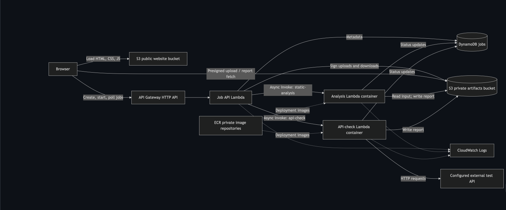

# Architecture and implementation plan

## 1. The core architecture

The browser is just the user interface. It does not run the checking tools itself.

The main pieces are:

- **S3 website bucket** — hosts the HTML/CSS/JavaScript frontend.
- **API Gateway** — exposes HTTP endpoints such as “create job,” “start job,” and “check status.”
- **Job API Lambda** — manages jobs, metadata, uploads, and worker dispatch.
- **Two worker Lambdas** — one performs static analysis; the other calls an external test API.
- **DynamoDB** — stores job status and metadata.
- **Private S3 artifacts bucket** — stores uploaded files and generated text reports.
- **ECR** — stores the container images for the two worker Lambdas.
- **CloudWatch Logs** — stores basic Lambda logs.

> **Important:** There are three Lambda functions, not two: the two actual tools plus a smaller “job API” Lambda that coordinates everything.



## 2. Why jobs are asynchronous

The tools may take several seconds, so the browser should not keep an HTTP request open waiting for them.

Instead:

```text
Create job → upload data → start job → return immediately
                              ↓
                      worker runs separately
                              ↓
Browser polls status ← DynamoDB
```

The design uses Lambda's built-in asynchronous invocation rather than introducing SQS immediately. The Job API invokes a worker with `InvocationType: "Event"`, so Lambda accepts the work and the API can return `202 Accepted`.

SQS could be as enhancement.

## 3. The job lifecycle is the central design idea

A job moves through states such as:

```text
CREATED
   ↓
QUEUED
   ↓
RUNNING
   ↓
SUCCEEDED
or
FAILED
```

These states are stored in DynamoDB.

For a file-analysis job, the important flow is:

1. Browser asks the API to create a job.
2. API creates the DynamoDB record.
3. API gives the browser a presigned S3 upload form.
4. Browser uploads directly to S3.
5. Browser tells the API to start the job.
6. API changes the state to `QUEUED`.
7. Worker changes it to `RUNNING`.
8. Worker reads the uploaded file and writes a report.
9. Worker changes the job to `SUCCEEDED`.
10. Browser polls until finished, then obtains a signed report URL.

This separation between job creation, upload, execution, and result retrieval is one of the main architectural ideas.

## 4. Presigned S3 URLs/forms avoid sending files through the API

The uploaded file does not travel through API Gateway or the Job API Lambda.

Instead, the browser uploads directly to S3 using temporary permission generated by the server:

```text
Browser ───────────────→ S3
        presigned upload

Browser → API Gateway → Lambda
        only metadata/control messages
```

This reduces load on the API and keeps large file handling out of Lambda/API Gateway.

The server also decides the S3 object key; the browser cannot arbitrarily choose where to write. Upload policies limit files to the intended location and size.

## 5. S3 versioning protects the job from file replacement

This is a subtle but important concept.

Suppose somebody uploads file version A and starts a job. If the upload URL could later be reused to replace the object with version B, the worker might accidentally analyze B.

The design avoids that by enabling S3 versioning and storing the exact `inputVersionId` when the job starts.

The worker therefore reads the exact version that was submitted, even if the object later changes.

The same idea is used for reports.

## 6. DynamoDB is acting as the system's state machine

DynamoDB is not storing the source code or report body. Those belong in S3.

Instead, DynamoDB stores things like:

- `jobId`
- `type`
- `status`
- `createdAt`
- `startedAt`
- `finishedAt`
- `inputKey`
- `inputVersionId`
- `reportKey`
- `reportVersionId`
- `deadlineAt`
- `executionId`
- `expiresAt`

The design relies heavily on **conditional updates**.

For example:

> A worker may change `QUEUED` → `RUNNING` only if the job is still `QUEUED`.

That prevents two duplicate Lambda deliveries from processing the same job simultaneously. If a second worker tries to claim it, its conditional update fails and it exits.

This is essentially an application-level state machine.

## 7. Duplicate-safe processing is important

Lambda asynchronous delivery is not guaranteed to happen exactly once.

So the application cannot assume:

> “If I sent one event, exactly one worker will execute it.”

Instead it must tolerate duplicate delivery.

That is why the design uses:

- Conditional DynamoDB updates.
- Job status checks.
- An `executionId`.
- Fixed S3 object versions.

The document explicitly says the worker must be duplicate-safe even without SQS.

The broader distributed-systems concept here is **idempotency**: performing the same request/event multiple times should not accidentally process the job multiple times.

## 8. There is an intentional reliability tradeoff

One of the most educational parts of the design is that it acknowledges a failure window:

```text
DynamoDB update: CREATED → QUEUED
                ↓
          process crashes
                ↓
Lambda invoke never happens
```

The database could therefore say `QUEUED` even though no worker was actually dispatched.

The Phase 1 design does not build a fully reliable transaction/outbox system. Instead, jobs have a ten-minute deadline; later status reads can convert stuck jobs into `FAILED`.

That is a conscious tradeoff: **simpler architecture vs. perfect dispatch reliability**.

For a learning demo, the document chooses simplicity.

## 9. The two existing JavaScript apps must be refactored

The current services apparently behave like HTTP servers.

For Lambda, the design wants the actual business logic separated from HTTP handling.

Instead of:

```javascript
app.listen(...)
```

the structure becomes conceptually:

```javascript
// analyze.js
function analyze(input) {
  // real checking logic
}

// handler.js
exports.handler = async event => {
  const input = ...
  const result = analyze(input)
  ...
}
```

The document explicitly recommends extracting the core processing functions and wrapping them in Lambda handlers.

That separation is a valuable software-design principle even outside AWS.

## 10. Two worker Lambdas use containers, but the API Lambda does not

The two larger worker services are packaged as Lambda container images stored in ECR.

The small Job API Lambda is packaged as a normal ZIP.

The reasoning is essentially:

- **Workers:** existing app + dependencies → container convenient.
- **Small API:** simple Node.js code → ZIP simpler.

The document suggests an AWS Lambda Node.js base image and shows a Dockerfile using Node.js 24.

## 11. Security is deliberately limited but still designed carefully

There is no user authentication in Phase 1.

That means anyone who discovers the API can potentially submit jobs, and possession of a job ID can allow report retrieval. The document explicitly treats this as a limitation and recommends non-sensitive demo data.

But there are still several security controls:

- Uploaded code is never executed.
- Artifacts bucket stays private.
- Browser gets only temporary signed S3 access.
- Reports are rendered using `textContent`, not `innerHTML`.
- Each Lambda gets a separate least-privilege IAM role.
- Logs should not contain uploaded source or signed URLs.

One particularly important frontend rule is:

```javascript
pre.textContent = report;
```

rather than:

```javascript
pre.innerHTML = report;
```

because the report could contain source code that looks like HTML.

## 12. The system intentionally avoids a VPC

A common AWS beginner assumption is that Lambda must be placed inside a VPC.

Here it does not need one.

The Lambdas need access to:

- AWS managed services.
- A public external API.

Default Lambda networking already supports that, so the design avoids:

- Private subnets.
- NAT Gateway.
- VPC endpoints.
- Load balancers.

That keeps both cost and complexity down.

## 13. Storage is intentionally temporary

The application is not designed as permanent storage.

Approximate retention is:

| Data | Approximate retention |
| --- | --- |
| Uploads | 1 day |
| Reports | 7 days |
| Job metadata | 7 days |

DynamoDB TTL and S3 lifecycle rules perform eventual cleanup, but the document emphasizes that these mechanisms do not guarantee deletion at an exact second.

The application therefore enforces expiry itself rather than relying solely on physical deletion.

## 14. Terraform manages infrastructure, not application builds

The Terraform structure is split into two stages:

```text
infra/
   registry/     ← first create ECR repositories

   app/          ← then deploy the actual application
```

The basic deployment sequence is:

```text
Terraform creates ECR
        ↓
Build Docker images
        ↓
Push images
        ↓
Get image digests
        ↓
Terraform deploys Lambda/S3/DynamoDB/API/etc.
```

An important Terraform concept here is that Terraform should deploy a specific immutable image digest:

```text
repository@sha256:...
```

rather than relying on a mutable tag such as `latest`.

## 15. Cost minimization strongly shapes the design

Several choices exist mainly because this is a low-volume learning project:

- No NAT Gateway.
- No load balancer.
- No provisioned Lambda concurrency.
- DynamoDB on-demand.
- No SQS initially.
- No custom domain required.
- Basic CloudWatch logs only.
- Short storage retention.

The sample workload estimates approximately $0.20/month before allowances and credits, while recommending $1/month as a planning allowance rather than treating that number as a hard cap.

## The 6 ideas I would remember most

If you're studying this document, these are the concepts worth understanding deeply:

1. **Serverless architecture** — API Gateway + Lambda + DynamoDB + S3 instead of permanent servers.
2. **Asynchronous jobs** — submit work now and poll for the result later.
3. **State machines and conditional updates** — DynamoDB controls `CREATED` → `QUEUED` → `RUNNING` → `SUCCEEDED`/`FAILED`.
4. **Idempotency** — duplicate worker invocations must not process the same job twice.
5. **Presigned S3 access** — browsers upload/download directly without receiving AWS credentials.
6. **Infrastructure as Code** — Terraform reproducibly defines the AWS infrastructure.
